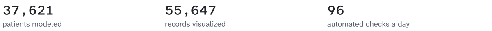

  <a href="https://github.com/JoaoVitorSesma"><picture><source media="(prefers-color-scheme: dark)" srcset="./assets/lang/globe-dark.svg"></picture></a>
  <a href="https://github.com/JoaoVitorSesma"><picture><source media="(prefers-color-scheme: dark)" srcset="./assets/lang/en-active-dark.svg"></picture></a>
  <a href="./README.pt-BR.md"><picture><source media="(prefers-color-scheme: dark)" srcset="./assets/lang/pt-idle-dark.svg"></picture></a>

<picture>
  <source media="(max-width: 600px) and (prefers-color-scheme: dark)" srcset="./assets/hero/hero-en-dark-mobile.svg">
  <source media="(max-width: 600px)" srcset="./assets/hero/hero-en-light-mobile.svg">
  <source media="(prefers-color-scheme: dark)" srcset="./assets/hero/hero-en-dark.svg">
  
</picture>

  <a href="mailto:jv0707204@gmail.com"><picture><source media="(prefers-color-scheme: dark)" srcset="./assets/cta/main-en-dark.svg"></picture></a>
  <a href="#selected-work"><picture><source media="(prefers-color-scheme: dark)" srcset="./assets/cta/alt-en-dark.svg"></picture></a>

<picture>
  <source media="(max-width: 600px) and (prefers-color-scheme: dark)" srcset="./assets/strip/walk-dark-mobile.svg">
  <source media="(max-width: 600px)" srcset="./assets/strip/walk-light-mobile.svg">
  <source media="(prefers-color-scheme: dark)" srcset="./assets/strip/walk-dark.svg">
  
</picture>

## Selected work

<picture>
  <source media="(max-width: 600px) and (prefers-color-scheme: dark)" srcset="./assets/work/numbers-en-dark-mobile.svg">
  <source media="(max-width: 600px)" srcset="./assets/work/numbers-en-light-mobile.svg">
  <source media="(prefers-color-scheme: dark)" srcset="./assets/work/numbers-en-dark.svg">
  
</picture>

<a href="https://github.com/JoaoVitorSesma/Predicao-da-Sobrevida-em-Pacientes-com-Cancer-Colorretal-IC">
<picture>
  <source media="(max-width: 600px) and (prefers-color-scheme: dark)" srcset="./assets/work/research-en-dark-mobile.svg">
  <source media="(max-width: 600px)" srcset="./assets/work/research-en-light-mobile.svg">
  <source media="(prefers-color-scheme: dark)" srcset="./assets/work/research-en-dark.svg">
  
</picture>
</a>

**Colorectal cancer survival.** Data preparation, Cox regression and Kaplan–Meier curves on São Paulo's cancer registry (FOSP). 
Python · pandas · lifelines · Jupyter · [Repository](https://github.com/JoaoVitorSesma/Predicao-da-Sobrevida-em-Pacientes-com-Cancer-Colorretal-IC) · [Open in Colab](https://colab.research.google.com/github/JoaoVitorSesma/Predicao-da-Sobrevida-em-Pacientes-com-Cancer-Colorretal-IC/blob/main/Predi%C3%A7%C3%A3o_da_Sobrevida_em_Pacientes_com_C%C3%A2ncer_Colorretal_COX.ipynb)

<a href="https://github.com/JoaoVitorSesma/Dashboard">
<picture>
  <source media="(max-width: 600px) and (prefers-color-scheme: dark)" srcset="./assets/work/dashboard-en-dark-mobile.svg">
  <source media="(max-width: 600px)" srcset="./assets/work/dashboard-en-light-mobile.svg">
  <source media="(prefers-color-scheme: dark)" srcset="./assets/work/dashboard-en-dark.svg">
  
</picture>
</a>

**Cervical cancer dashboard.** Interactive filters, trends and regional survival views for public FOSP data. 
Python · Streamlit · Plotly · GeoPandas · Folium · [Repository](https://github.com/JoaoVitorSesma/Dashboard)

<a href="https://github.com/JoaoVitorSesma/codex-reset-monitor">
<picture>
  <source media="(max-width: 600px) and (prefers-color-scheme: dark)" srcset="./assets/work/monitor-en-dark-mobile.svg">
  <source media="(max-width: 600px)" srcset="./assets/work/monitor-en-light-mobile.svg">
  <source media="(prefers-color-scheme: dark)" srcset="./assets/work/monitor-en-dark.svg">
  
</picture>
</a>

**Codex reset monitor.** Watches public sources, classifies reset announcements with deterministic rules, deduplicates across sources and alerts Discord. 
Python · GitHub Actions · Cloudflare Workers · pytest · [Repository](https://github.com/JoaoVitorSesma/codex-reset-monitor)

## Toolbox

**Data & research:** Python · pandas · NumPy · lifelines · Jupyter 
**Apps & visualization:** Streamlit · Plotly · GeoPandas · Folium 
**Automation:** GitHub Actions · Cloudflare Workers · Discord webhooks 
**Coursework:** [Flutter · Dart](https://github.com/JoaoVitorSesma/2026_maua_ecm252_flutter)

## Let's talk

Want to talk about **data, AI or healthcare**? [Send me an email](mailto:jv0707204@gmail.com)

Every figure on this page is drawn from the projects' own data by [`scripts/build_assets.py`](./scripts/build_assets.py); sources in [`assets/SOURCES.md`](./assets/SOURCES.md). Animations stop when your system asks for reduced motion. Set in Atkinson Hyperlegible, designed by the Braille Institute for readers with low vision.
