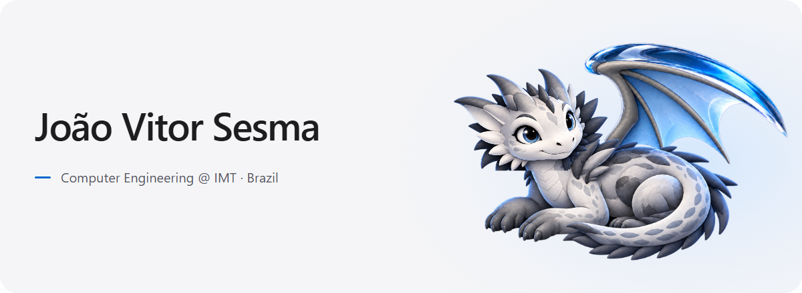

<picture>
  <source media="(prefers-reduced-motion: reduce) and (max-width: 600px) and (prefers-color-scheme: dark)" srcset="./assets/hero-mobile-dark.png">
  <source media="(prefers-reduced-motion: reduce) and (max-width: 600px)" srcset="./assets/hero-mobile-light.png">
  <source media="(prefers-reduced-motion: reduce) and (prefers-color-scheme: dark)" srcset="./assets/hero-desktop-dark.png">
  <source media="(prefers-reduced-motion: reduce)" srcset="./assets/hero-desktop-light.png">
  <source media="(max-width: 600px) and (prefers-color-scheme: dark)" srcset="./assets/hero-mobile-dark.gif">
  <source media="(max-width: 600px)" srcset="./assets/hero-mobile-light.gif">
  <source media="(prefers-color-scheme: dark)" srcset="./assets/hero-desktop-dark.gif">
  <source media="(prefers-color-scheme: light)" srcset="./assets/hero-desktop-light.gif">
  
</picture>

I'm **João Vitor Morimoto Sesma**, a Computer Engineering student at **Instituto Mauá de Tecnologia, Brazil**.

I work on **survival analysis, interactive dashboards and automation**.

[Explore my work ↓](#selected-work) · [Email ↗](mailto:jv0707204@gmail.com)

## Selected work

<picture>
  <source media="(prefers-color-scheme: dark)" srcset="./assets/projects/survival-dark.svg">
  <source media="(prefers-color-scheme: light)" srcset="./assets/projects/survival-light.svg">
  
</picture>

### [Cancer Survival Analysis](https://github.com/JoaoVitorSesma/Predicao-da-Sobrevida-em-Pacientes-com-Cancer-Colorretal-IC)

Exploring colorectal cancer survival with FOSP data, **Cox regression** and **Kaplan–Meier curves**.

**My contribution:** Data preparation, statistical modeling and survival visualizations in research notebooks.

**Tools:** Python · pandas · lifelines · Jupyter

 

<picture>
  <source media="(prefers-color-scheme: dark)" srcset="./assets/projects/dashboard-dark.svg">
  <source media="(prefers-color-scheme: light)" srcset="./assets/projects/dashboard-light.svg">
  
</picture>

### [FOSP Health Dashboard](https://github.com/JoaoVitorSesma/Dashboard)

A Streamlit app for exploring cervical cancer diagnosis trends and regional survival estimates. **My contribution:** Interactive filters, charts and geographic visualizations.

**Tools:** Python · Streamlit · Plotly · GeoPandas · Folium

 

<picture>
  <source media="(prefers-color-scheme: dark)" srcset="./assets/projects/monitor-dark.svg">
  <source media="(prefers-color-scheme: light)" srcset="./assets/projects/monitor-light.svg">
  
</picture>

### [Codex Reset Monitor](https://github.com/JoaoVitorSesma/codex-reset-monitor)

A monitor for public Codex usage-reset announcements, with relevant alerts sent to Discord. **Project focus:** Source classification, event deduplication and scheduled alerts.

**Tools:** Python · GitHub Actions · Cloudflare Workers

## Tools & technologies

 **Data & research:** Python · pandas · NumPy · lifelines · Plotly

 **Applications:** Streamlit · GeoPandas · Folium

 **Automation:** GitHub Actions · Cloudflare Workers

## Currently exploring

**Flutter and Dart:** Building applications and exercises through [ECM252 coursework at IMT](https://github.com/JoaoVitorSesma/2026_maua_ecm252_flutter).

## Let's connect

Want to discuss my projects or an internship opportunity? [Send me an email ↗](mailto:jv0707204@gmail.com)

[GitHub](https://github.com/JoaoVitorSesma) · [All repositories](https://github.com/JoaoVitorSesma?tab=repositories)
