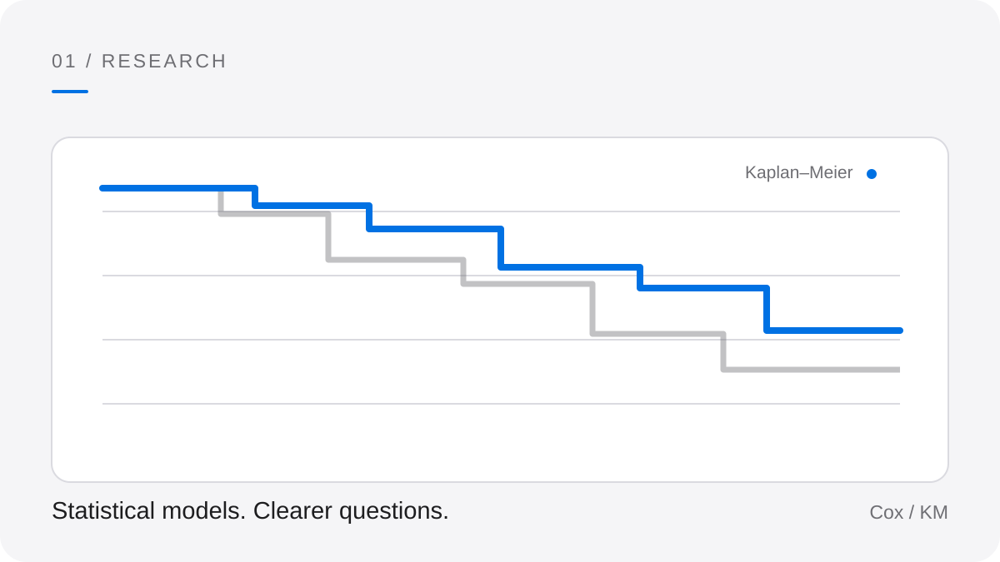
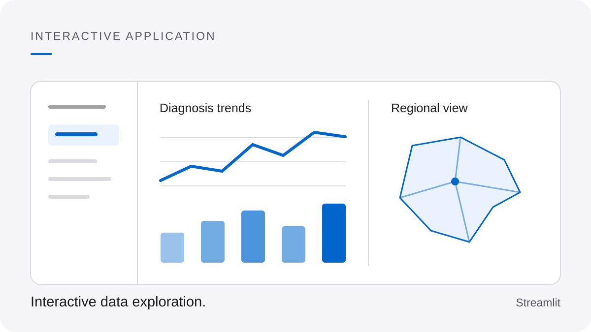
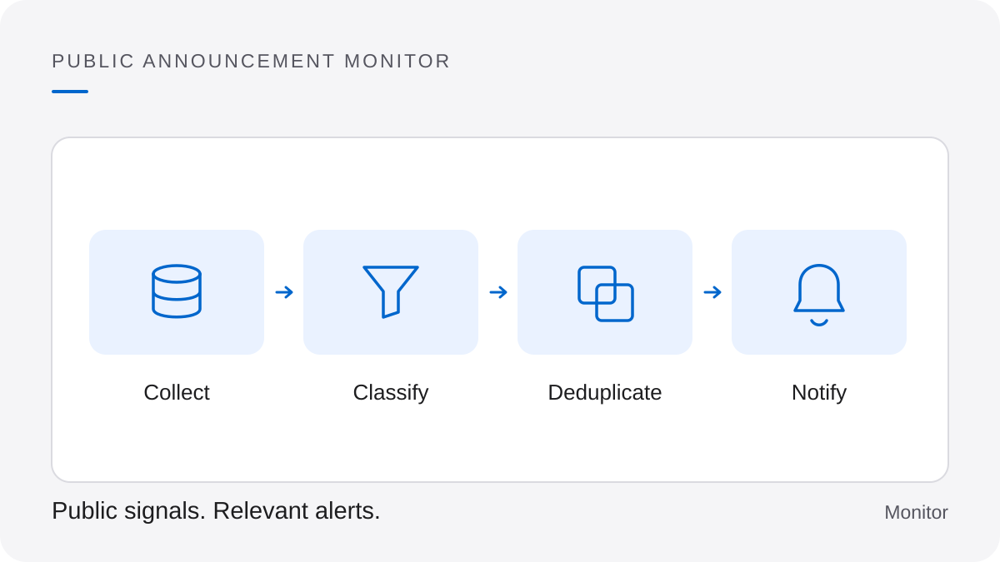

<picture>
  <source media="(prefers-color-scheme: dark)" srcset="./assets/banner-dark.png">
  <source media="(prefers-color-scheme: light)" srcset="./assets/banner-light.png">
  
</picture>

**Computer Engineering student at Instituto Mauá de Tecnologia (IMT), Brazil.**

I'm João Vitor Morimoto Sesma. My public projects bring together data analysis, interactive applications and automation.

[Projects](#selected-projects) · [Tools](#tools--technologies) · [Learning](#currently-exploring) · [Contact](#connect)

## Selected Projects

<picture>
  <source media="(prefers-color-scheme: dark)" srcset="./assets/projects/survival-dark.svg">
  <source media="(prefers-color-scheme: light)" srcset="./assets/projects/survival-light.svg">
  
</picture>

### [Cancer Survival Analysis](https://github.com/JoaoVitorSesma/Predicao-da-Sobrevida-em-Pacientes-com-Cancer-Colorretal-IC)

Research notebooks exploring colorectal cancer survival using FOSP data, Cox regression and Kaplan–Meier curves.

**My work:** Data preparation, statistical modeling and survival visualizations.

**Built with:** Python · lifelines · Jupyter

[Explore the research →](https://github.com/JoaoVitorSesma/Predicao-da-Sobrevida-em-Pacientes-com-Cancer-Colorretal-IC)

 

<picture>
  <source media="(prefers-color-scheme: dark)" srcset="./assets/projects/dashboard-dark.svg">
  <source media="(prefers-color-scheme: light)" srcset="./assets/projects/dashboard-light.svg">
  
</picture>

### [FOSP Health Dashboard](https://github.com/JoaoVitorSesma/Dashboard)

A Streamlit application for exploring cervical cancer diagnosis trends and regional survival estimates.

**My work:** Interactive filters, trend charts and geographic visualizations.

**Built with:** Python · Streamlit · Plotly · GeoPandas · Folium

[Explore the dashboard →](https://github.com/JoaoVitorSesma/Dashboard)

 

<picture>
  <source media="(prefers-color-scheme: dark)" srcset="./assets/projects/monitor-dark.svg">
  <source media="(prefers-color-scheme: light)" srcset="./assets/projects/monitor-light.svg">
  
</picture>

### [Codex Reset Monitor](https://github.com/JoaoVitorSesma/codex-reset-monitor)

An automated monitor that classifies public Codex usage-reset announcements and sends relevant alerts to Discord.

**Project focus:** Source classification, event deduplication and scheduled alerts.

**Built with:** Python · GitHub Actions · Cloudflare Workers

[Explore the monitor →](https://github.com/JoaoVitorSesma/codex-reset-monitor)

## Tools & Technologies

 **Data & research:** Python · pandas · NumPy · lifelines · Plotly

 **Apps & coursework:** Streamlit · Flutter · Dart

 **Automation:** GitHub Actions · Cloudflare Workers

## Currently Exploring

- **Flutter and Dart:** Applications and exercises from [ECM252 coursework at IMT](https://github.com/JoaoVitorSesma/2026_maua_ecm252_flutter).

## Connect

[Email](mailto:jv0707204@gmail.com) · [GitHub](https://github.com/JoaoVitorSesma) · [All repositories](https://github.com/JoaoVitorSesma?tab=repositories)
