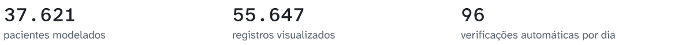

  <a href="./README.pt-BR.md"><picture><source media="(prefers-color-scheme: dark)" srcset="./assets/lang/globe-dark.svg"></picture></a>
  <a href="https://github.com/JoaoVitorSesma"><picture><source media="(prefers-color-scheme: dark)" srcset="./assets/lang/en-idle-dark.svg"></picture></a>
  <a href="./README.pt-BR.md"><picture><source media="(prefers-color-scheme: dark)" srcset="./assets/lang/pt-active-dark.svg"></picture></a>

<picture>
  <source media="(max-width: 600px) and (prefers-color-scheme: dark)" srcset="./assets/hero/hero-pt-dark-mobile.svg">
  <source media="(max-width: 600px)" srcset="./assets/hero/hero-pt-light-mobile.svg">
  <source media="(prefers-color-scheme: dark)" srcset="./assets/hero/hero-pt-dark.svg">
  
</picture>

  <a href="mailto:jv0707204@gmail.com"><picture><source media="(prefers-color-scheme: dark)" srcset="./assets/cta/main-pt-dark.svg"></picture></a>
  <a href="#projetos"><picture><source media="(prefers-color-scheme: dark)" srcset="./assets/cta/alt-pt-dark.svg"></picture></a>

<picture>
  <source media="(max-width: 600px) and (prefers-color-scheme: dark)" srcset="./assets/strip/walk-dark-mobile.svg">
  <source media="(max-width: 600px)" srcset="./assets/strip/walk-light-mobile.svg">
  <source media="(prefers-color-scheme: dark)" srcset="./assets/strip/walk-dark.svg">
  
</picture>

## Projetos

<picture>
  <source media="(max-width: 600px) and (prefers-color-scheme: dark)" srcset="./assets/work/numbers-pt-dark-mobile.svg">
  <source media="(max-width: 600px)" srcset="./assets/work/numbers-pt-light-mobile.svg">
  <source media="(prefers-color-scheme: dark)" srcset="./assets/work/numbers-pt-dark.svg">
  
</picture>

<a href="https://github.com/JoaoVitorSesma/Predicao-da-Sobrevida-em-Pacientes-com-Cancer-Colorretal-IC">
<picture>
  <source media="(max-width: 600px) and (prefers-color-scheme: dark)" srcset="./assets/work/research-pt-dark-mobile.svg">
  <source media="(max-width: 600px)" srcset="./assets/work/research-pt-light-mobile.svg">
  <source media="(prefers-color-scheme: dark)" srcset="./assets/work/research-pt-dark.svg">
  
</picture>
</a>

**Sobrevida no câncer colorretal.** Preparação de dados, regressão de Cox e curvas de Kaplan–Meier no registro de câncer de São Paulo (FOSP). 
Python · pandas · lifelines · Jupyter · [Repositório](https://github.com/JoaoVitorSesma/Predicao-da-Sobrevida-em-Pacientes-com-Cancer-Colorretal-IC) · [Abrir no Colab](https://colab.research.google.com/github/JoaoVitorSesma/Predicao-da-Sobrevida-em-Pacientes-com-Cancer-Colorretal-IC/blob/main/Predi%C3%A7%C3%A3o_da_Sobrevida_em_Pacientes_com_C%C3%A2ncer_Colorretal_COX.ipynb)

<a href="https://github.com/JoaoVitorSesma/Dashboard">
<picture>
  <source media="(max-width: 600px) and (prefers-color-scheme: dark)" srcset="./assets/work/dashboard-pt-dark-mobile.svg">
  <source media="(max-width: 600px)" srcset="./assets/work/dashboard-pt-light-mobile.svg">
  <source media="(prefers-color-scheme: dark)" srcset="./assets/work/dashboard-pt-dark.svg">
  
</picture>
</a>

**Dashboard de câncer do colo do útero.** Filtros interativos, tendências e sobrevida por região com dados públicos da FOSP. 
Python · Streamlit · Plotly · GeoPandas · Folium · [Repositório](https://github.com/JoaoVitorSesma/Dashboard)

<a href="https://github.com/JoaoVitorSesma/codex-reset-monitor">
<picture>
  <source media="(max-width: 600px) and (prefers-color-scheme: dark)" srcset="./assets/work/monitor-pt-dark-mobile.svg">
  <source media="(max-width: 600px)" srcset="./assets/work/monitor-pt-light-mobile.svg">
  <source media="(prefers-color-scheme: dark)" srcset="./assets/work/monitor-pt-dark.svg">
  
</picture>
</a>

**Monitor de resets do Codex.** Acompanha fontes públicas, classifica anúncios de reset com regras determinísticas, deduplica entre fontes e avisa no Discord. 
Python · GitHub Actions · Cloudflare Workers · pytest · [Repositório](https://github.com/JoaoVitorSesma/codex-reset-monitor)

## Ferramentas

**Dados e pesquisa:** Python · pandas · NumPy · lifelines · Jupyter 
**Aplicações e visualização:** Streamlit · Plotly · GeoPandas · Folium 
**Automação:** GitHub Actions · Cloudflare Workers · webhooks do Discord 
**Aprendendo:** [Flutter · Dart](https://github.com/JoaoVitorSesma/2026_maua_ecm252_flutter)

## Vamos conversar

Aberto a estágios em **ciência de dados, análise em saúde e automação**. [Me mande um e-mail](mailto:jv0707204@gmail.com)

Todas as figuras desta página são desenhadas a partir dos dados dos próprios projetos por [`scripts/build_assets.py`](./scripts/build_assets.py); fontes em [`assets/SOURCES.md`](./assets/SOURCES.md). As animações param quando o sistema pede movimento reduzido. Tipografia em Atkinson Hyperlegible, desenhada pelo Braille Institute para leitores com baixa visão.
